# Pathau (पठाउ)

[](https://github.com/aryanpariyarofficial/pathau/actions/workflows/ci.yml)
[](LICENSE)

**Send files, folders and text between your phone and your PC, or between two PCs, over your own Wi-Fi.**
No cable, no cloud, no account, no internet data. Free and open source.

तपाईंको फोन र कम्प्युटर, वा दुई कम्प्युटरबीच फाइल, फोल्डर र टेक्स्ट Wi-Fi बाट सिधै पठाउनुहोस्। केबल चाहिँदैन, इन्टरनेट डाटा खर्च हुँदैन।

<table>
  <tr>
    <td width="72%">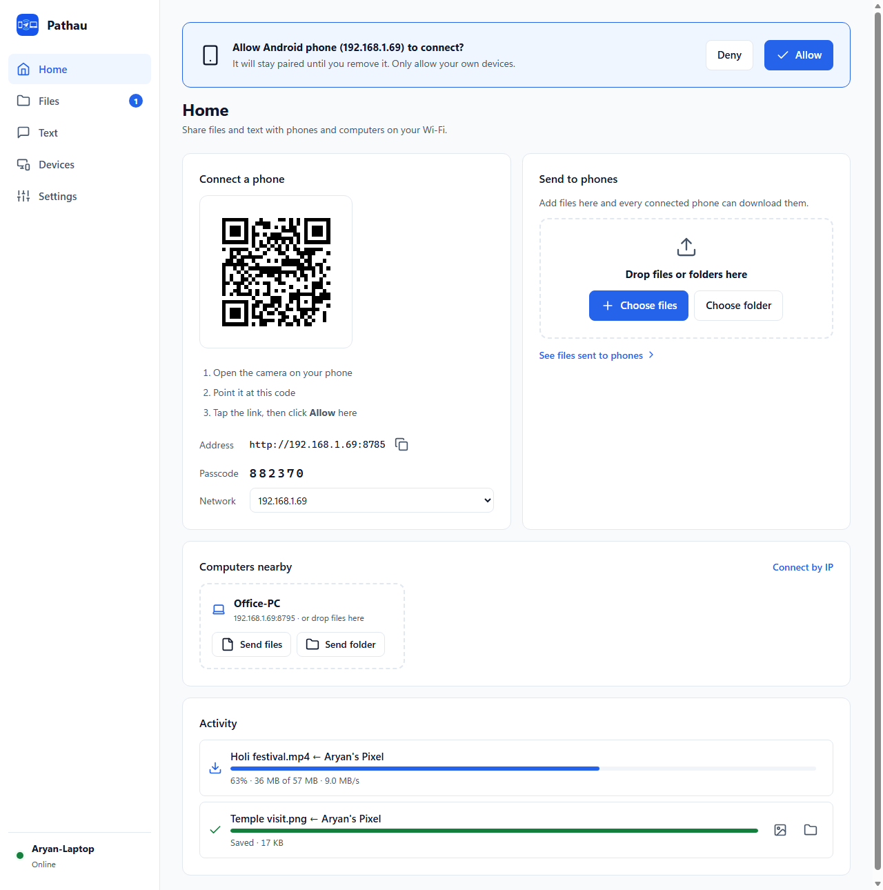</td>
    <td width="28%">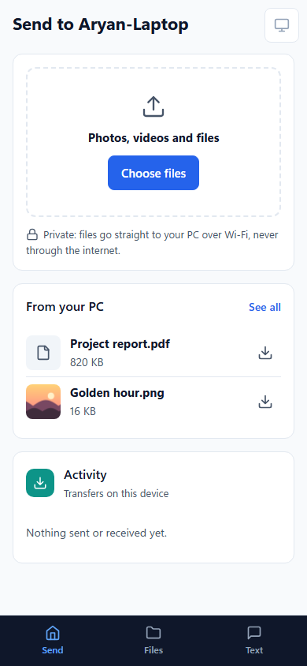</td>
  </tr>
  <tr>
    <td align="center"><sub>On your PC</sub></td>
    <td align="center"><sub>On your phone, in the browser. No app.</sub></td>
  </tr>
</table>

## Contents
- [Why Pathau](#why-pathau)
- [Features](#features)
- [Screenshots](#screenshots)
- [Quick start](#quick-start)
- [How to use it](#how-to-use-it)
- [How it works](#how-it-works)
- [Security](#security)
- [Troubleshooting](#troubleshooting)
- [Build from source](#build-from-source)
- [Contributing](#contributing)

## Why Pathau
| Instead of… | The problem | With Pathau |
|---|---|---|
| USB cable | Find the cable, drivers, "Allow file access" prompts | Scan a QR code once |
| Messenger / WhatsApp | Photos and videos get compressed, and there are size limits | Original quality, any size (many GB) |
| Google Drive, OneDrive | Uploads use internet data and are slow; your files go to a company's servers | Goes straight across your Wi-Fi at full speed, with no internet needed |
| Paid apps | License keys, accounts | Free and open source |

## Features
**Phone ↔ PC**
- Scan the QR code and Pathau opens in the phone's browser. **Nothing to install** on Android or iPhone.
- Send photos, videos and documents to the PC in **full original quality**.
- **PC → phone:** drop files or folders on *Send to phones*, and every paired phone sees them under *Files* with a Download button.
- **Pair once:** after you click *Allow* on the PC, the phone stays paired, even after restarts, until you remove it.
- **On your home screen:** add Pathau to the home screen with its own icon. On iPhone it opens full screen, like an app.

**PC ↔ PC**
- Other PCs running Pathau **appear automatically**. Click *Send files* / *Send folder*, or drag and drop onto a computer.
- The other PC clicks **Accept** first. Folders keep their structure.
- **Every file is SHA-256 verified.** A damaged copy is deleted and sent again automatically.

**Text & clipboard**
- Send links, codes and OTPs between devices. Text from your phone lands on the PC clipboard, ready for Ctrl+V.
- **OTP detection:** from "Your OTP is 482913, valid for 5 min…", only `482913` is copied.
- **iPhone:** an iPhone Shortcut can forward OTP messages **automatically**, with no app.

**Files**
- One place for **received files**, **files sent to phones** and **shared folders**.
- Grid or list view, sorted by name, size or date, with search.
- Full-screen photo, video and audio preview with ← → navigation. **Open** and **Show in folder** (reuses your open Explorer window).
- **Shared folders** (read-only): phones browse and download single files, or whole folders as .zip. Downloads can resume.

**Always ready, safe by default**
- Starts with Windows and lives in the **system tray**.
- New devices need your **Allow**, passcodes work once, and 10 wrong tries pauses a device. See [Security](#security).
- Big files stream straight to disk with live progress and speed. **Pause, resume or cancel** any transfer from either device. Existing files are never overwritten.
- **Windows notifications** for received files and texts. When a phone asks to pair or a PC wants to send files, Pathau opens itself.
- One ~12 MB `.exe`. No installer, no admin rights, no internet.
- Light and dark mode on PC and phone: follow the system, or pick one (sidebar button or Settings → Appearance).

## Screenshots
| | |
|---|---|
| 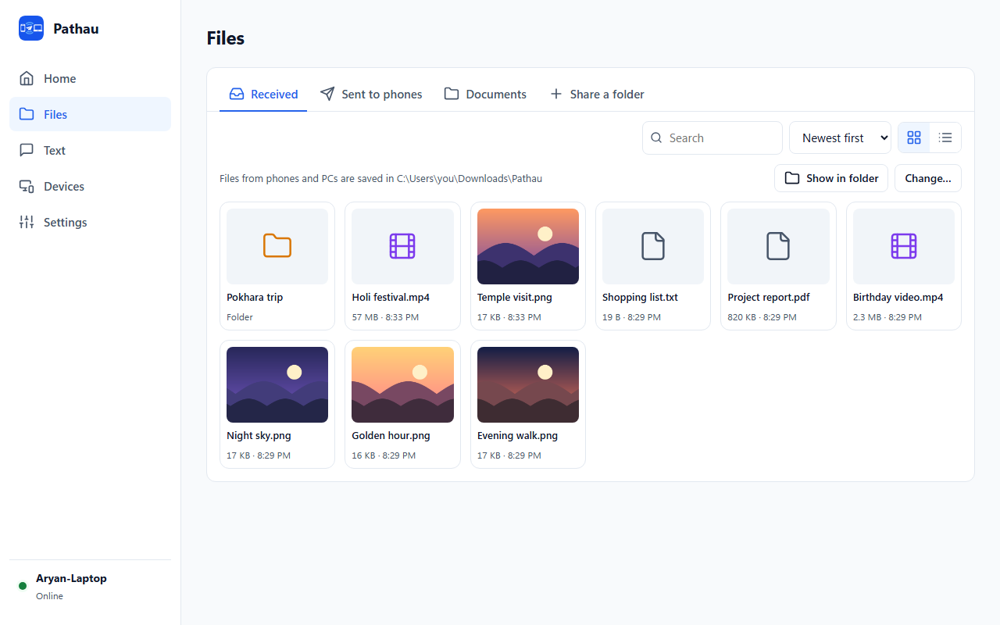 | 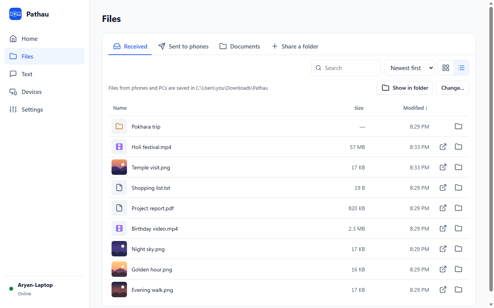 |
| **Files**: grid view with thumbnails | **Files**: list view, sortable by name, size and date |
|  | 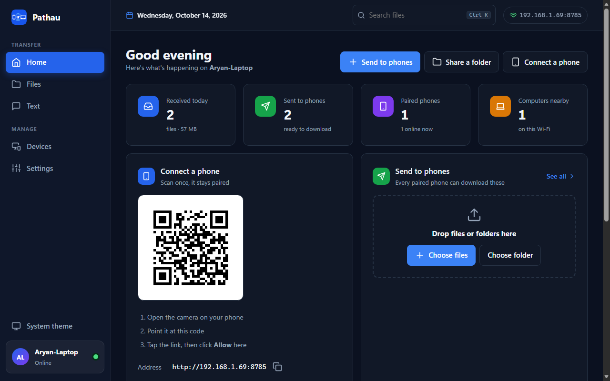 |
| **Preview** with ← → navigation | **Dark mode** follows your system |
| 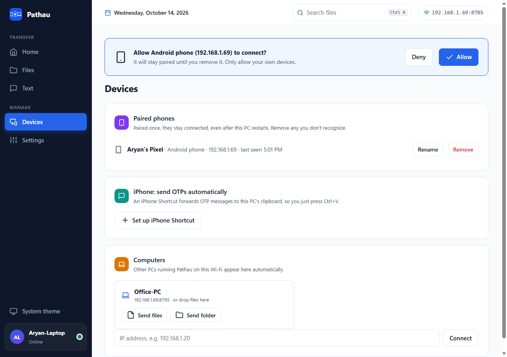 | 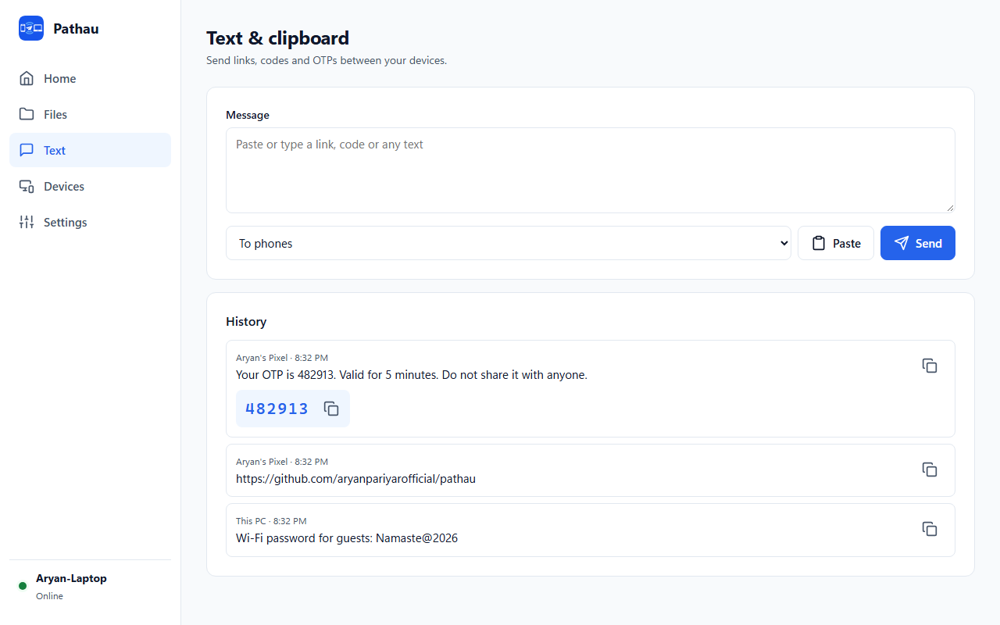 |
| **Devices**: approve new phones, rename or remove paired ones | **Text**: history, with OTP codes pulled out |

| | | | |
|---|---|---|---|
| 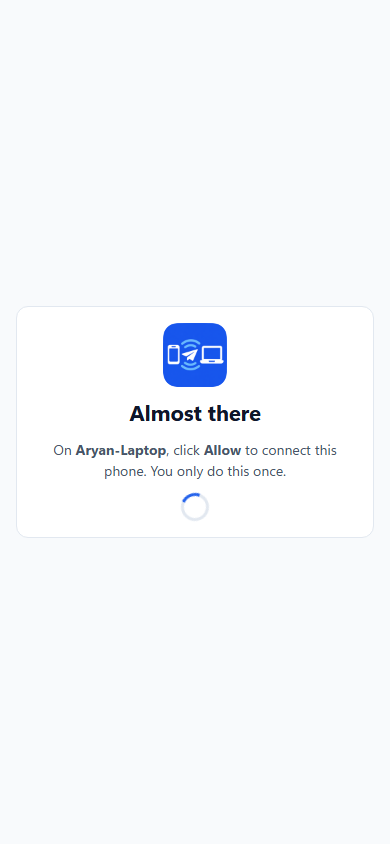 |  | 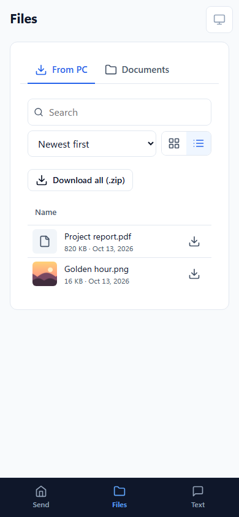 | 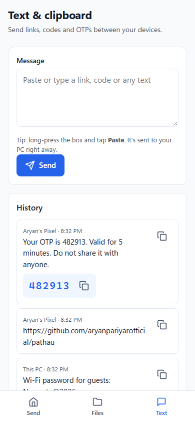 |
| Pairing: waiting for *Allow* | Send to PC | Download from PC | Text & OTPs |

## Quick start
1. **Download** `pathau-…-windows-amd64.exe` from [Releases](../../releases) and run it. (Use `arm64` for ARM laptops like Surface Pro X / Snapdragon.)
2. When Windows Firewall asks, click **Allow** for *Private networks*.
3. Pathau opens in your browser and adds a tray icon.
4. **Phone:** open the camera, scan the QR code, tap the link, then click **Allow** on the PC.

> **"Windows protected your PC"?** Windows SmartScreen shows this for new apps that aren't code-signed yet. Click **More info → Run anyway**. Every release is built from this source by [GitHub Actions](.github/workflows/release.yml) and published with SHA-256 checksums. See [verifying a download](SECURITY.md#verifying-a-download).

## How to use it
<details open>
<summary><b>Phone → PC</b>: send photos, videos and files</summary>

1. On the phone, open Pathau (bookmark it after the first scan) and tap **Choose files**.
2. Pick photos, videos or documents. Progress shows on both the phone and the PC.
3. Files are saved in `Downloads\Pathau` on the PC. See them under **Files → Received**, preview them, or click **Show in folder**.

**iPhone tip:** for full original quality, in the photo picker tap **Options** at the top and choose **Current**.
</details>

<details>
<summary><b>Put Pathau on your phone's home screen</b></summary>

After pairing, Pathau shows a card with the steps for your phone:
- **iPhone (Safari):** Share → **Add to Home Screen**. It opens full screen, like an app.
- **Android (Chrome):** ⋮ → **Add to Home screen**. Tap the Pathau icon instead of scanning again.

Why not a one-tap "Install app"? Browsers only offer that for HTTPS sites, and certificates can't be issued for home-network addresses like `192.168.1.5`.
</details>

<details>
<summary><b>PC → phone</b>: send files to your phone</summary>

1. On the PC, **Home → Send to phones**: drop files or folders, or click **Choose files**.
2. The phone gets a notice. Under **Send** (*From your PC*) or **Files → From PC**, tap ⬇ to download.
3. Remove items you no longer want to share under **Files → Sent to phones**.
</details>

<details>
<summary><b>PC ↔ PC</b>: send to another computer</summary>

1. Run Pathau on both PCs on the same network. They appear under **Computers nearby**.
2. Click **Send files** / **Send folder**, or drag files onto the computer's card.
3. The other PC clicks **Accept**. Files are checked with SHA-256 on arrival.

Not showing up? Use **Devices → Connect by IP** (e.g. `192.168.1.20`).
</details>

<details>
<summary><b>Text, clipboard and OTPs</b></summary>

- **Phone → PC:** on the phone, open **Text**, long-press the box and tap **Paste**. It's sent immediately and lands on the PC clipboard (Ctrl+V).
- **PC → phone:** on the PC, open **Text**, type or click **Paste**, choose *To phones* and **Send**. The phone shows it with a Copy button.
- **PC → PC:** choose the computer in the *To* list.
- OTP messages get the code pulled out and highlighted. Only the code is copied.
</details>

<details>
<summary><b>iPhone: OTPs to the PC automatically</b> (Shortcuts, no app)</summary>

1. On the PC: **Devices → Set up iPhone Shortcut**. Copy the key (it's shown only once).
2. On the iPhone: **Shortcuts → Automation → + → Message**. Set *Message Contains* to `OTP`, choose **Run Immediately**.
3. Add the action **Get Contents of URL**:
   - URL `http://<your-PC-IP>:8765/api/text`, Method `POST`
   - Header `Authorization` = `Bearer <your key>`
   - Request Body **JSON**: key `text` = **Shortcut Input**
4. Text yourself "OTP 1234". The code appears on the PC clipboard.

For any copied text: make a Shortcut with **Get Clipboard** then the same **Get Contents of URL** (value: Clipboard), and run it with **Back Tap** (Settings → Accessibility → Touch → Back Tap).

To revoke it, remove *iPhone Shortcut* under **Devices**.
</details>

<details>
<summary><b>Shared folders</b>: let phones browse a folder</summary>

**Files → Share a folder** and pick a folder. Phones see it under **Files**, where they can browse, preview and download (single files, or *Download all* as .zip). It's read-only: nobody can change or delete your files. Click **Stop sharing** to remove it.
</details>

<details>
<summary><b>Devices, tray and settings</b></summary>

- **Devices:** approve new phones, rename them ("Aryan's Pixel") or **Remove** them, which locks them out instantly.
- **Tray icon:** left-click opens Pathau; right-click offers *Start with Windows* and *Quit*.
- **Settings:** PC name, save folder (**Change…**), a fixed passcode (default: a new random one that works once), and auto-copy of phone text.
</details>

## How it works
Pathau is a single Go program. Each PC runs a small web server on your local network, and every screen (on the PC and on phones) is a web page served by it. Nothing goes through the internet.

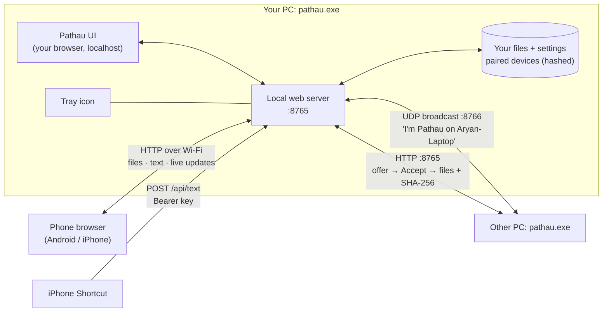

**The pieces**

| Piece | Technology | What it does |
|---|---|---|
| Web server | Go `net/http` | Serves the UI and the API. Big files are **streamed** straight to disk, never held in memory. |
| UI | Plain HTML/CSS/JS, embedded in the `.exe` | One page that adapts: full control on the PC, a simpler phone layout. |
| Live updates | Server-Sent Events | Transfer progress, incoming text and files appear instantly. |
| Discovery | UDP broadcast on port 8766 | PCs announce themselves every 3 s, so others list them automatically. |
| Checksums | SHA-256 in an HTTP trailer | The sender hashes while streaming; the receiver compares and deletes a damaged copy. |
| Safe file access | Go `os.Root` | Received and shared paths can't escape their folder, even through `..` or symlinks. |
| Windows integration | Win32/COM via Go (`fyne.io/systray`, `zenity`, `go-ole`) | Tray, start with Windows, modern folder picker, Explorer. No scripts. |
| QR codes | `skip2/go-qrcode` | Encodes `http://<PC-IP>:8765/?k=<one-time passcode>`. |

**Pairing a phone**

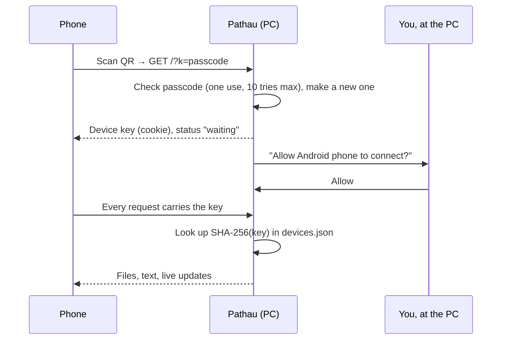

**Sending to another PC**

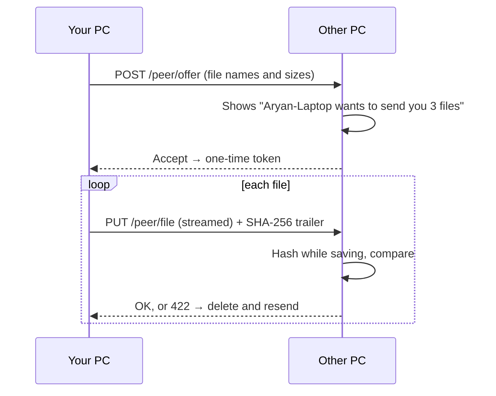

**Where things are stored**

| What | Where |
|---|---|
| Received files | `Downloads\Pathau` (changeable) |
| Settings | `%APPDATA%\Pathau\config.json` |
| Paired devices (hashed keys only) | `%APPDATA%\Pathau\devices.json` |
| Files sent to phones | `%APPDATA%\Pathau\Outbox` |
| Start with Windows | `HKCU\…\CurrentVersion\Run\Pathau` (per user, no admin) |

**Network ports:** TCP **8765** (web and transfers) and UDP **8766** (discovery), on your local network only.

## Security
Pathau is built to be safe on your home or office network:
- **Local only**: no internet, no accounts, no telemetry.
- **Two-step pairing**: you need the passcode (in the QR code) **and** your *Allow* on the PC. Passcodes work once.
- **Revocable devices**: remove any device to lock it out instantly. Only hashes of device keys are stored.
- **Brute-force protection**: 10 wrong passcodes pause that device for 5 minutes.
- **Read-only sharing**: shared folders can't be changed or deleted from other devices.
- **No surprises**: received programs are never launched with one click, and previews run sandboxed.
- **No admin rights, no scripts**, and builds are made in public by GitHub Actions with checksums.

Details, limits and how to report a problem: **[SECURITY.md](SECURITY.md)**.

## Troubleshooting
<details>
<summary><b>The phone can't open the page</b></summary>

- The phone and PC must be on the **same Wi-Fi** (not guest Wi-Fi, not mobile data).
- Windows Firewall: allow Pathau for **Private networks**, and set your Wi-Fi to **Private** (Settings → Network → Wi-Fi → your network → *Private*).
- Some routers isolate devices ("AP/client isolation"); turn it off in the router settings.
</details>

<details>
<summary><b>The phone says "Not secure"</b></summary>

Browsers show this for every `http://` address. Real certificates (the padlock) can't be issued for home network addresses like `192.168.1.5`. Your Wi-Fi password encrypts the traffic, pairing protects access, and nothing leaves your network. See [SECURITY.md](SECURITY.md#known-limits).
</details>

<details>
<summary><b>The phone stopped connecting after a restart</b></summary>

Your router may have given the PC a new IP address, and the phone's bookmark points to the old one. Scan the QR code again, or set a **DHCP reservation** for your PC in the router so its address never changes.
</details>

<details>
<summary><b>Another PC doesn't appear</b></summary>

Use **Devices → Connect by IP**. Discovery uses UDP broadcasts, which some networks block.
</details>

<details>
<summary><b>Where are my files?</b></summary>

**Files → Received → Show in folder**, or Settings → *Save files to*.
</details>

## Build from source
Requires [Go](https://go.dev/dl/) 1.25+. No C compiler needed.
```sh
go test ./...
go build -trimpath -ldflags "-s -w -H windowsgui" -o pathau.exe .   # tray app, no console window
```
Linux and macOS build too (`GOOS=linux go build`), without the tray for now.

**Project layout**

| File | What |
|---|---|
| `main.go` | Server, routes, auth guard, settings, live events, text |
| `devices.go` | Pairing (approval, permanent devices, Shortcut keys) and OTP detection |
| `files.go` | File sources (received, sent to phones, shared), uploads, downloads, zip |
| `peer.go` | Discovery and PC-to-PC transfers with SHA-256 |
| `shell_windows.go` | Tray, start with Windows, folder dialog, Explorer (Win32/COM) |
| `web/` | The UI, embedded into the `.exe` |
| `main_test.go` | Tests: auth, pairing, path safety, checksums, OTP detection |
| `rsrc_windows_*.syso` | Icon, version info and manifest for the `.exe` (from `go-winres`) |

**Releasing:** `git tag v1.0.0 && git push origin v1.0.0`. [GitHub Actions](.github/workflows/release.yml) tests, builds `amd64` and `arm64` executables with version info, and publishes them with `SHA256SUMS.txt`.

## Contributing
Bug reports and ideas are welcome: open an [issue](../../issues). For security problems, see [SECURITY.md](SECURITY.md). Pull requests should keep `go vet ./...` and `go test ./...` passing.

## License
[MIT](LICENSE). Free to use, change and share.
